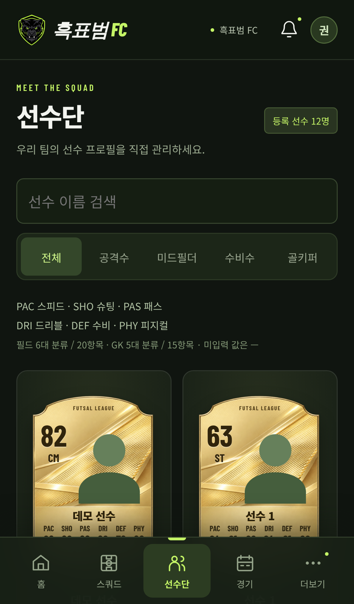
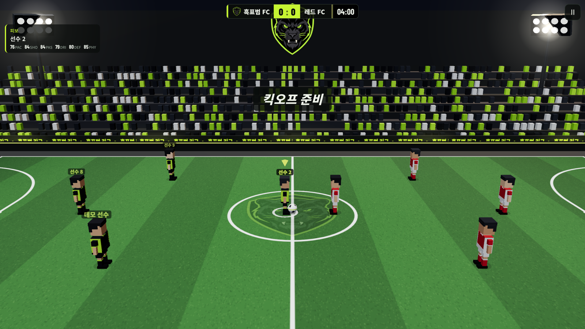
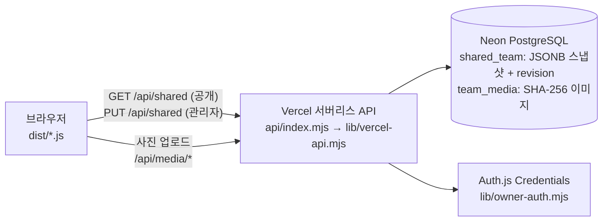

# 풋살 스쿼드 플랫폼

부대 풋살의 선수 관리와 팀 편성을 돕는 서비스입니다.

선수마다 능력치 카드를 만들고, 포지션에 맞춘 OVR로 실력이 비슷한 두 팀을 나눕니다. 관리자 한 명이 선수와 팀 정보를 편집하고, 나머지 사람은 읽기 전용으로 봅니다.

- 스택: HTML/CSS/JavaScript(빌드 도구 없음), Vercel 서버리스 함수(Node 24), Neon PostgreSQL(JSONB), Auth.js

| 선수 카드 | 3D 풋살 (컴퓨터 대전) |
| --- | --- |
|  |  |

화면은 샘플 데이터로 찍었습니다.

## 기능

| 기능 | 설명 | 상태 |
| --- | --- | --- |
| 선수 카드 | 세부 능력치(1~99)를 입력하면 6개 항목(PAC·SHO·PAS·DRI·DEF·PHY, 골키퍼는 5개)과 카드 등급이 계산됩니다. 사진 업로드, 확대·축소, 부상 표시, 특기 포함 | 운영 중 |
| 포지션별 OVR | 같은 능력치라도 포지션마다 가중치를 달리 적용해 OVR을 계산합니다 (`dist/abilities.js`) | 운영 중 |
| 균형 팀 편성 | 참가 선수로 나올 수 있는 모든 팀 조합을 탐색해 평균 OVR 차이와 포지션 쏠림이 가장 작은 조합을 고릅니다. 랜덤 편성도 지원합니다 (`dist/team-builder.js`) | 운영 중 |
| 스쿼드·포메이션 | 경기장 위에 선수를 배치하고 포메이션을 저장합니다 | 운영 중 |
| 3D 풋살 미리보기 | three.js로 그린 5대5 풋살 경기(컴퓨터 대전). 클럽 선수 카드의 능력치가 경기 속 움직임에 반영됩니다 | 개발 중 (미배포) |
| 온라인 대전 | 5대5~7대7, 한 사람이 선수 한 명을 조작하는 실시간 경기. 빈자리는 컴퓨터가 채웁니다 | 개발 중 (미배포) |

## 구조



- 팀 데이터 전체는 `shared_team` 테이블의 JSONB 한 행에 `revision` 번호와 함께 저장됩니다 (`neon/schema.sql`).
- 사진은 내용의 SHA-256 해시를 키로 하는 변경 불가 객체로 `team_media`에 저장되고, 데이터베이스 접속 정보는 서버 안에만 있습니다.
- 접근 제어는 서버에서 합니다. 읽기는 누구나, 쓰기는 로그인한 관리자만 가능하며 비로그인 쓰기는 403입니다. 로그인 시도 횟수 제한, Origin 확인(CSRF 방어)이 함께 들어 있습니다.
- `npm run build`가 `dist/`를 `public/`으로 복사하고, Vercel은 `public/`을 정적 파일로 배포합니다.

온라인 대전(개발 중)은 별도의 Cloudflare Worker에서 돌아갑니다. 방 하나가 Durable Object 하나이고, 선수 카드는 메인 앱의 공개 API(`GET /api/shared`)에서 읽기 전용으로 가져옵니다. 메인 데이터베이스에 쓰는 권한은 없습니다.

## 핵심 설계

### 1. 동시 편집 보호 (revision 비교, 충돌 시 409)

두 기기에서 동시에 편집해도 나중 저장이 먼저 저장된 내용을 덮어쓰지 않게 합니다. 클라이언트는 마지막으로 읽은 `revision`을 `expectedRevision`으로 함께 보내고, 서버는 DB의 `revision`과 같을 때만 저장합니다.

```sql
UPDATE shared_team SET snapshot = $1, revision = revision + 1, ...
 WHERE id = 'team' AND revision = $expected RETURNING *
```

비교와 갱신이 SQL 한 문장 안에서 일어나서 별도 락 없이 원자적입니다. 갱신된 행이 없으면 API가 409를 돌려주고, 화면은 이 기기의 입력을 브라우저에 백업한 뒤 최신본을 다시 불러올지 묻습니다.

- 서버: `lib/neon-store.mjs` `save()`, `lib/vercel-api.mjs` `PUT /api/shared`
- 클라이언트: `dist/shared-sync.js`, `dist/shared-refresh-policy.js` (편집 중에는 원격 갱신을 미루는 순수 함수)

### 2. 이미지 업로드 검증 (크기, 형식, 해시)

- 업로드 전: PNG·JPEG·WebP만, 8MB 이하만 받습니다. 파일은 2MB 이하 조각으로 나눠 올립니다.
- 업로드 후: 서버가 조각을 합친 바이트의 앞부분(매직 넘버)으로 실제 형식을 다시 판별하고, 선언한 형식과 다르거나 SHA-256 해시가 맞지 않으면 거부합니다.
- 같은 해시의 이미지는 이미 검증된 것이므로 다시 올리지 않고 재사용합니다.
- DB 제약으로도 한 번 더 막습니다: 해시 형식, 허용 MIME, 크기 상한 (`neon/schema.sql`).

코드: `lib/vercel-api.mjs` `/api/media/sign`, `/api/media/chunk/*`, `/api/media/complete`

### 3. 경기 계산(core.js)과 화면(game.js) 분리

`dist/futsal/core.js`는 DOM이나 three.js에 의존하지 않는 순수 시뮬레이션입니다. 공 물리, 선수·골키퍼 AI, 태클, 시드 기반 난수를 담고 `createMatch()`와 `step(match, dt, input)`만 밖으로 내놓습니다. `game.js`(입력, 로비)와 `scene.js`(three.js 렌더링)는 이 상태를 읽어 그리기만 합니다.

덕분에 같은 `core.js`를 브라우저(컴퓨터 대전), Node 테스트, Cloudflare Worker의 온라인 대전 서버(`room-engine.mjs`)가 그대로 함께 씁니다. 온라인 대전은 서버가 60Hz로 계산하고 초당 20번 상태를 보내며, 브라우저는 자기 선수만 미리 예측해 움직이고 다른 선수는 보간해 그립니다.

## 핵심 파일 위치

| 파일 | 역할 | 상태 |
| --- | --- | --- |
| `lib/vercel-api.mjs` | API 라우팅, 권한 확인, 저장 충돌 409, 업로드 검증 | 운영 |
| `lib/neon-store.mjs` | Neon 저장소 어댑터 (조건부 UPDATE) | 운영 |
| `lib/owner-auth.mjs` | 관리자 로그인 (Auth.js Credentials, scrypt 해시) | 운영 |
| `dist/team-builder.js` | 균형·랜덤 팀 편성 | 운영 |
| `dist/abilities.js` | 능력치 항목, 포지션 가중치, OVR 계산 | 운영 |
| `dist/futsal/core.js` | 풋살 경기 시뮬레이션 (화면 의존 없음) | 개발 중 |
| `dist/futsal/game.js` | 3D 풋살 입력·로비, `scene.js`가 three.js 렌더링 | 개발 중 |
| `realtime/src/worker.mjs` | 온라인 대전 Worker: 방 코드 발급, WebSocket을 방별 Durable Object로 연결 | 개발 중 |
| `realtime/src/room-engine.mjs` | 온라인 대전 방 엔진: 서버 권위 게임 루프, 입력 처리, 빈자리 AI 대체, 재접속 | 개발 중 |

3D 풋살은 `dist/futsal.html`, 온라인 대전 화면은 `dist/futsal-league.html`에서 시작합니다.

## 로컬 실행

필요한 것: Node.js 24, 본인 소유의 PostgreSQL(Neon 무료 플랜이면 충분)

```bash
npm install
cp .env.example .env.local        # 값은 아래 순서대로 채웁니다
npm test                          # 데이터베이스 없이 돌아가는 단위 테스트
```

1. 새 데이터베이스를 만들고 `DATABASE_URL`을 `.env.local`에 넣습니다.
2. 스키마를 만들고 빈 팀 데이터 한 행을 넣습니다. 반드시 새로 만든 개발용 데이터베이스에서만 실행하세요.
   ```bash
   node --env-file=.env.local scripts/setup-neon.mjs
   psql "<DATABASE_URL 값>" -c "INSERT INTO shared_team(id,revision,snapshot,updated_by) VALUES('team',1,'{\"data\":{},\"photos\":{}}','setup');"
   ```
3. 관리자 비밀번호 해시와 세션 비밀값을 만들어 `.env.local`에 넣습니다.
   ```bash
   read -rs PW && PW="$PW" node --input-type=module -e "import {hashPassword} from './lib/owner-auth.mjs'; console.log(await hashPassword(process.env.PW))"; unset PW
   openssl rand -hex 32              # SESSION_SECRET
   ```
4. 빌드하고 실행합니다.
   ```bash
   npm run build
   node --env-file=.env.local scripts/preview-vercel.mjs
   ```
   http://127.0.0.1:4195 에서 열리고, 관리자 아이디는 `TEAM_ADMIN_EMAIL` 값입니다.

온라인 대전 서버는 `realtime/` 폴더에서 `npm install && npm run dev`로 실행합니다. `realtime/wrangler.jsonc`의 `ROSTER_URL`이 로컬 앱의 `/api/shared`를 가리키므로 로컬 선수 카드를 그대로 씁니다.

## 폴더 안내

- `dist/` 프런트엔드 원본 (직접 편집하는 곳), `public/` 빌드 결과 (커밋하지 않음)
- `api/`, `lib/` 서버 코드, `realtime/` 온라인 대전 서버(Cloudflare Workers), `neon/` 스키마, `tests/` Node 내장 테스트 러너
- `.github/workflows/` PR과 `main` 푸시마다 테스트(122개)와 빌드를 GitHub Actions로 자동 실행
- `worker/`, `drizzle/`, `supabase/`, `lib/supabase-store.mjs`, `docs/legacy/` 이전 저장소(Cloudflare D1/R2, Supabase)를 쓰던 시절의 호환 코드입니다. 운영에는 쓰지 않고 테스트를 위해 남겨 두었습니다.

## 만든 방식

요구사항 정의, 설계 결정, 검증은 직접 했고 코드 대부분은 AI 코딩 도구(Codex, 이후 Claude)로 작성했습니다. 팀 편성과 게임 속 컴퓨터 선수는 규칙 기반 알고리즘이며 머신러닝을 쓰지 않습니다.

## 외부 자산

- three.js: MIT 라이선스 (`dist/vendor/three/LICENSE`)
- MediaPipe Tasks Vision: Apache 2.0 (`dist/vendor/mediapipe/LICENSE`)
- 출처와 라이선스는 `ASSET-SOURCES.txt`에 적어 두었습니다.

## 공개본 안내

실제로 운영 중인 서비스의 코드를 공개용으로 정리한 저장소입니다. 선수 이름은 "선수 1~11" 같은 가명으로 바꿨고, 개인 사진, 소속 단체 엠블럼, 저작권이 있는 이미지와 음악은 뺐습니다. 실제 선수 데이터와 사진은 저장소가 아니라 데이터베이스에만 있습니다.
